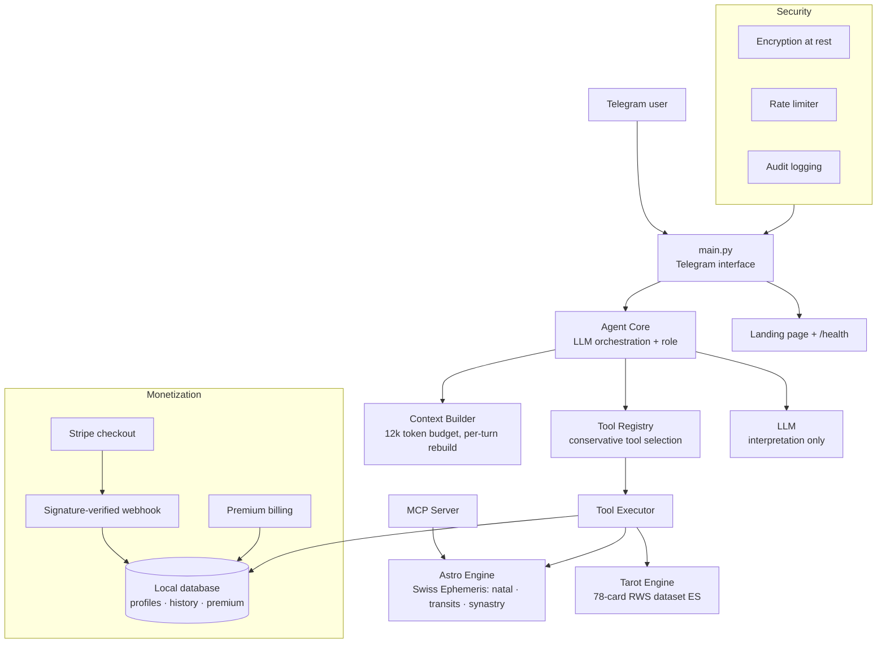

# ORION — Autonomous AI Astrology Agent (Showcase)

> Public showcase of an AI agent project. **No source code is published here.** This repository documents the architecture, stack, and engineering practices of a private project. Source code and a live walkthrough are available on request.

## Overview

ORION is an **autonomous LLM agent** delivered through Telegram that acts as an astrology guide. Its defining engineering decision: **the LLM never computes — it interprets**. All astronomical values come from exact Swiss Ephemeris calculations executed as agent tools, so every chart, transit, and synastry aspect is mathematically grounded with zero hallucinations; the model's role is limited to empathetic, symbolic interpretation of exact numbers.

The platform also includes a full **freemium monetization layer** (Stripe subscriptions), a **three-phase security program**, an **MCP server**, and a **conversation memory system** — a production-grade agentic AI product, not a chatbot wrapper.

## Highlights

- **Hallucination-free grounding**: exact astronomy (natal charts, transits, synastry) computed by tools, never by the LLM
- Native **function calling** architecture with a modular tool registry / executor / schema separation
- **Token budgeting**: 12,000-token estimated input budget per turn, oldest history trimmed first, real usage accumulated across calls
- **78-card tarot dataset** (Spanish, Rider-Waite-Smith imagery, public domain) with its own engine and tests
- **Stripe payments in production flow**: monthly premium subscription with signature-verified webhooks and account linking
- **Three-phase security program**: encryption at rest, rate limiting, prompt-injection tests, scope guardrails, and audit logging
- **MCP server** exposing the agent's capabilities through the Model Context Protocol

## Stack

| Layer | Technology |
| --- | --- |
| Language | Python 3.10+ |
| Astronomy | Swiss Ephemeris (pyswisseph), Placidus house system |
| Agent | Native LLM function calling via LiteLLM (no LangChain/CrewAI) |
| Interface | Telegram Bot API, natural conversation |
| Payments | Stripe subscriptions + secure webhooks |
| Database | Local-first database (profiles, premium status, reading history) |
| Validation | Pydantic |
| Extras | MCP server, chart rendering, landing page |

## Architecture

**Key decisions:**

- **Tools compute, LLM interprets.** The astro engine exposes `calculate_natal_chart()`, `calculate_transits()`, and `calculate_synastry()` returning compact, exact results; the model never invents positions. This grounds the product in verifiable mathematics.
- **Conservative tool selection.** Tool schemas are kept separate from the orchestrator; when user intent is ambiguous, the agent retains the full toolset instead of guessing.
- **Deterministic context.** The system context is rebuilt every turn, stale profiles are dropped, and the input budget trims oldest history first while preserving the current turn.
- **Local-first privacy.** All user data stays in a local database — nothing in the cloud, nothing shared with third parties.

## Monetization (freemium → premium)

- Free tier: 12,000 tokens/day; premium tier: 200,000 tokens/day plus synastry
- Premium via **Stripe monthly subscription** (MXN $199), auto-granting by phone whitelist, or upgrade commands
- Webhook handling with signature verification, premium activation linking, and an intention-detection flow for checkout inside the conversation
- Cache layer for premium status to avoid repeated billing lookups

## Security program (3 phases)

1. **Encryption** at rest for sensitive stored data and key management tooling
2. **Adversarial defenses**: prompt-injection test suite, scope guardrails keeping the agent inside its astrological domain, rate limiting per user
3. **Operational audit**: audit logging, security checklist, and a documented audit report driving the roadmap

## Testing

Focused test suite covering the areas that matter most:

- `test_injection.py` — prompt-injection resistance
- `test_scope_guardrails.py` — the agent stays in its domain
- `test_synastry_grounding.py` — synastry outputs match engine calculations
- `test_astro_engine_timezone.py` — historical timezone / DST correctness
- `test_natal_chart_cache.py`, `test_premium_billing.py`, `test_mcp_server.py`, `test_tool_registry.py`, `test_tarot_engine.py`

## Skills demonstrated

Agentic AI architecture (function calling, tool registry, context budgeting), hallucination-free LLM grounding, LLM productization (Telegram distribution, MCP), payment integration (Stripe webhooks), freemium tiering, security hardening (encryption, rate limiting, injection defense, audit), domain-driven engineering (Swiss Ephemeris, tarot dataset), testing strategy for AI systems.

---

*This is a documentation-only showcase. The private repository contains the full implementation: agent core, astro and tarot engines, billing, security layer, MCP server, tests, and deployment scripts.*
